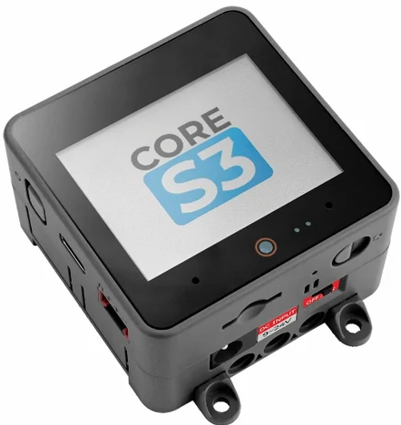
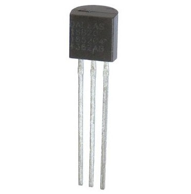
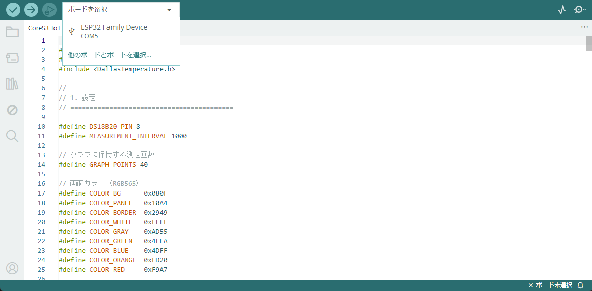
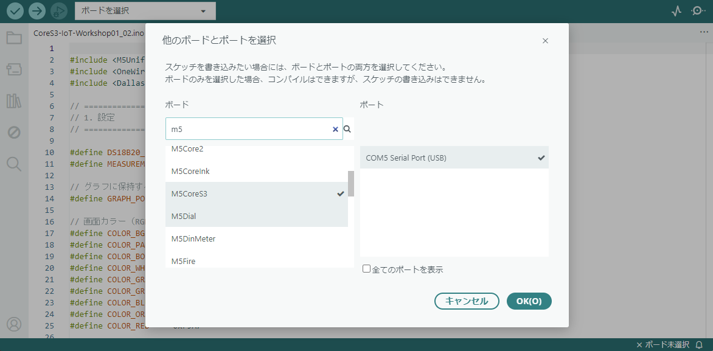
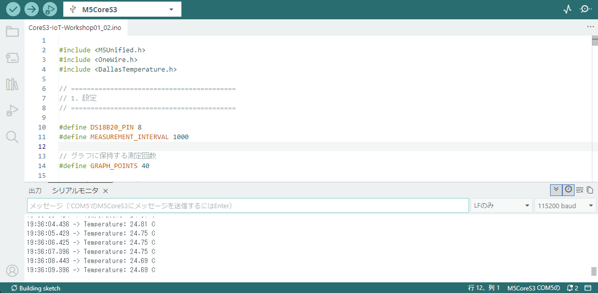
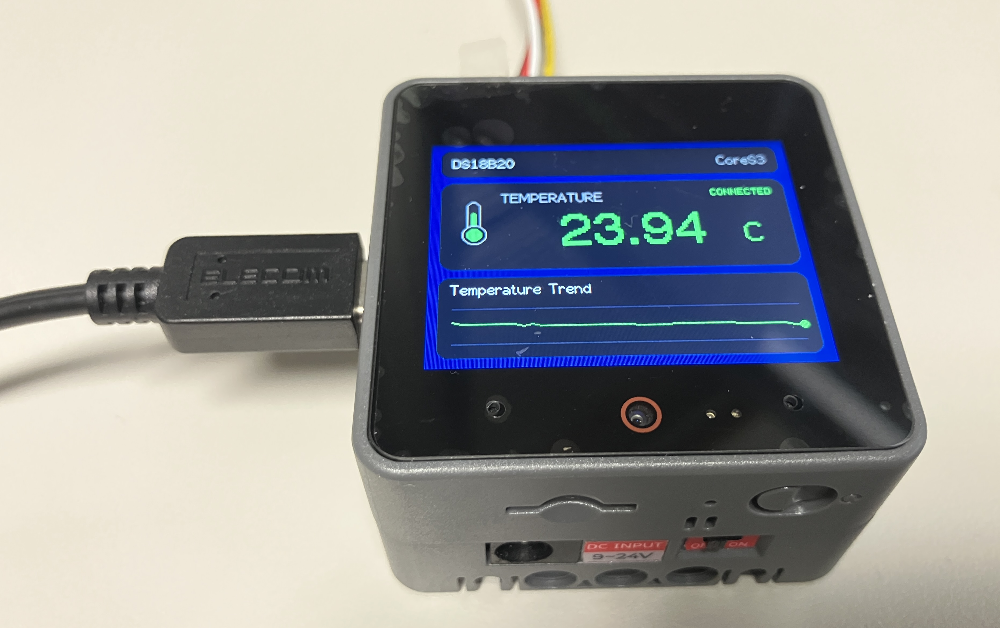

# STEP 1：M5Stack CoreS3で温度を測ろう

[🏠 トップ](../README.md) | [← 事前準備](00-setup.md) | [次へ：STEP 2 →](02-server.md)

## 今日ここでできるようになること

**M5Stack CoreS3に接続した温度センサで測定した温度を、パソコンの画面とCoreS3に搭載されているディスプレイに表示します。**

## 1. 配線する

**USBケーブルを必ず外してから** 作業します。

### 1-1. DS18B20の端子を確認する

まず、温度センサ「DS18B20」の端子配置を確認しましょう。

DS18B20には、以下の3つの端子があります。

| 端子名 | 役割 |
| --- | --- |
| VDD | 電源 |
| DQ | データの送受信 |
| GND | グランド（0V） |

各端子の位置は、以下のデータシートで確認できます。

📄 **[DS18B20 データシート（PDF）](https://akizukidenshi.com/goodsaffix/DS18B20.pdf)**

データシートの **1ページ目「PIN CONFIGURATIONS」** にある
**TO-92（DS18B20）の「BOTTOM VIEW」** を確認してください。

> [!IMPORTANT]
> **BOTTOM VIEWとは？**
>
> 部品を端子側（下側）から見た図です。
> 表側から見た場合とは左右が逆になるため、
> 端子の位置を間違えないように注意してください。

### 1-2. CoreS3のGroveポートを確認する

今回は、M5Stack CoreS3と温度センサの接続に**Groveポート（PORT.B）** を使用します。

Groveポートとは、センサなどの電子部品を簡単に接続するためのコネクタです。

CoreS3のPORT.Bには、以下の4つの端子があります。

| 端子の色 | 役割 |
| --- | --- |
| 黒 | GND（グランド） |
| 赤 | 5V（電源） |
| 黄 | GPIO9 |
| 白 | GPIO8 |

今回は、**GPIO8を温度センサのデータ通信に使用します。**

Groveポートの詳しい仕様については、以下の公式ドキュメントを確認してください。

📖 **[M5Stack CoreS3公式ドキュメント](https://docs.m5stack.com/en/core/CoreS3)**

> [!IMPORTANT]
> **ケーブル接続時の注意点**
>
> ケーブルの色だけで端子を判断せず、
> CoreS3の端子配置とケーブルの接続先を確認してください。
>

### 1-3. CoreS3とDS18B20を接続する

端子の位置とGroveポートの仕組みを確認できたら、実際に配線してみましょう。

今回は、**DS18B20を5Vで動作させ、データ線をGPIO8に接続します。**

| DS18B20の端子 | 接続先 |
| --- | --- |
| VDD（電源） | CoreS3の5V |
| DQ（データ） | CoreS3のGPIO8 |
| GND（グランド） | CoreS3のGND |

> [!NOTE]
> センサの端子配置は、データシートで確認してください。

### 1-4. 配線を確認する

配線が完了したら、以下の項目を確認しましょう。

- [ ] DS18B20のVDDが5Vにつながっている
- [ ] DS18B20のDQがGPIO8につながっている
- [ ] DS18B20のGNDがGNDにつながっている

**配線が完了したら、USBケーブルを接続する前に講師に確認してもらいましょう。**

| M5Stack CoreS3 | DS18B20 |
| :---: | :---: |
|  |  |

> [!NOTE]
> 配線を終えたら、USBケーブルを接続する前に
> 講師に確認してもらいましょう。

## 2. プログラムを書き込む

配線が完了したら、CoreS3に温度測定用のプログラムを書き込みます。

今回は、**Arduino IDE** というソフトウェアを使用します。

### 2-1. プログラムを開く

1. Arduino IDEを開きます。
2. COreS3をUSBケーブルでパソコンに接続します。
3. [STEP 1の完成版プログラム](../code/step1/step1.ino) を開き、コードをコピーして新しいスケッチに貼り付けます。

### 2-2. ボードとポートを設定する

CoreS3にプログラムを書き込むためには、Arduino IDEで **ボード** と **ポート** を設定する必要があります。

- **ボード**：使用するマイコンの種類
- **ポート**：パソコンとCoreS3を接続する通信経路

以下の手順で設定しましょう。

1. Arduino IDEの画面上部にある **ボード選択メニュー（▼）** をクリックします。
2. 選択候補となるポートの項目が出てくるので、それをクリックします。
3. ボード一覧から **M5CoreS3** を選択します。
4. CoreS3が接続されているポートを選択します。
5. **「OK」** をクリックして設定を確定します。



*図1：Arduino IDEのボード選択メニュー*



*図2：ボードとポートの選択*

> [!NOTE]
> **ボードとポートについて**
>
> 画像では、ボードに「M5CoreS3」、ポートに「COM5」を選択しています。
>
> 実際に選択するボードは使用するM5Stackの種類によって異なります。
> 講師から指定されたボードを選択してください。
>
> また、ポート番号（COM4など）はパソコンによって異なります。
> 必ず自分のパソコンに表示されたポートを選択してください。

### 2-3. プログラムを書き込む

ボードとポートの設定が完了したら、プログラムを書き込みます。

1. Arduino IDEの画面左上にある **「→」（書き込み）ボタン** をクリックします。
2. プログラムのコンパイルと書き込みが開始されます。
3. 画面下部の出力欄を確認し、エラーが表示されていないことを確認します。

> [!TIP]
> **コンパイルとは？**
>
> 人間が書いたプログラムを、マイコンが実行できる形式に変換することです。
>
> Arduino IDEでは、書き込みボタンを押すと、コンパイルしたプログラムがESP32に転送されます。

> [!IMPORTANT]
> **書き込みに失敗した場合**
>
> 書き込みに失敗した場合は、ボードやポートの選択、USBケーブルの接続を確認してください。
>
> 解決しない場合は講師に相談しましょう。

## 3. 動作を確かめよう

プログラムの書き込みが完了したら、温度を測定してみましょう。

### 3-1. シリアルモニタを開く

**シリアルモニタ** は、CoreS3からパソコンに送られたメッセージを確認できる機能です。

以下の手順で測定結果を確認します。

1. Arduino IDEの **「ツール → シリアルモニタ」** を選択するか、画面右上のシリアルモニタアイコンをクリックします。
2. 画面下部に表示されたシリアルモニタを確認します。
3. 通信速度を **115200 baud** に設定します。
4. 温度が繰り返し表示されることを確認します。



*図3：温度測定プログラムの実行結果*

温度が正常に測定されると、シリアルモニタには次のような結果（例）が表示されます。

```text
Temperature: 23.75 C
Temperature: 23.81 C
Temperature: 24.06 C
```

> [!NOTE]
> **表示される温度について**
>
> 測定値は周囲の温度によって変化するため、上記の数値と完全に一致する必要はありません。
>
> また、今回のプログラムでは約2秒ごとに新しい測定結果が表示されます。


### 3-2. CoreS3のディスプレイで温度を確認する

CoreS3にはディスプレイが搭載されています。

今回のプログラムでは、シリアルモニタだけでなく、**CoreS3本体のディスプレイにも温度が表示されます。**

画面を確認してみましょう。

```text
Temperature

23.94 C
```



*図4：CoreS3のディスプレイに表示された温度*

**確認するポイント**

- [ ] CoreS3のディスプレイに温度が表示された
- [ ] シリアルモニタと同じ温度が表示された
- [ ] センサを温めると表示温度が変化した

> [!NOTE]
> 表示される温度は周囲の環境によって変化します。
> 例と同じ数値である必要はありません。

### 3-3. 温度を変化させてみよう

温度が表示されたら、実際にセンサの温度を変えてみましょう。

1. センサに触れる前の温度を確認します。
2. センサの先端を指でしばらく触ります。
3. シリアルモニタに表示される温度の変化を観察します。
4. センサから指を離し、温度がどのように変化するか確認します。

**確認するポイント**

- センサを指で触れると、温度はどう変化しましたか？
- 指を離した後、温度はどうなりましたか？
- 温度が変化するまでに時間差はありましたか？

温度が表示されない場合は [トラブル対処ページ](troubleshooting.md) を確認してください。

## 4. プログラムの重要な部分

今回のプログラムでは、温度センサから取得したデータをCoreS3のディスプレイとパソコンのシリアルモニタに表示しています。

また、測定した温度を記録し、CoreS3のディスプレイに折れ線グラフとして表示する機能もあります。

### 4-1. 温度を測定するための設定

| コード | 意味 |
| --- | --- |
| `#include <M5Unified.h>` | CoreS3のディスプレイなどを操作するためのライブラリ |
| `#include <OneWire.h>` | DS18B20と通信するためのライブラリ |
| `#include <DallasTemperature.h>` | DS18B20から温度を取得するためのライブラリ |
| `#define DS18B20_PIN 8` | 温度センサを接続するGPIO番号 |
| `#define MEASUREMENT_INTERVAL 1000` | 温度を測定する間隔（1000ミリ秒＝1秒） |
| `#define GRAPH_POINTS 40` | グラフに保持する測定データの最大数 |

> [!TIP]
> **ミリ秒とは？**
>
> プログラムでは、時間をミリ秒（ms）で指定することがあります。
>
> **1000ミリ秒 = 1秒** です。
>
> 例えば、`MEASUREMENT_INTERVAL` を `2000` に変更すると、
> 測定間隔は2秒になります。

### 4-2. 温度を取得する処理

| コード | 意味 |
| --- | --- |
| `OneWire oneWire(DS18B20_PIN);` | 温度センサと通信するための準備 |
| `DallasTemperature sensors(&oneWire);` | 温度センサを操作するための準備 |
| `sensors.begin();` | 温度センサを初期化する |
| `sensors.setResolution(12);` | 温度センサの分解能を12ビットに設定する |
| `sensors.requestTemperatures();` | 温度センサに測定を指示する |
| `sensors.getTempCByIndex(0);` | 測定した温度を℃で取得する |

実際に温度を取得しているのは、次の部分です。

```cpp
sensors.requestTemperatures();
float temperature = sensors.getTempCByIndex(0);
```

取得した温度は、`temperature` という変数に保存されます。

### 4-3. 測定結果を表示する処理

| コード | 意味 |
| --- | --- |
| `Serial.begin(115200);` | パソコンとのシリアル通信を開始する |
| `Serial.print(...)` | シリアルモニタに文字や数値を表示する |
| `M5.begin(cfg);` | CoreS3を初期化する |
| `M5.Display.setRotation(1);` | ディスプレイを横向きに設定する |
| `drawBaseScreen();` | ディスプレイの基本画面を描画する |
| `drawTemperature(temperature, valid);` | 測定温度や接続状態を表示する |
| `drawGraph();` | 温度変化のグラフを描画する |

今回のプログラムでは、温度の測定結果を**パソコンとCoreS3本体の両方**で確認できます。

### 4-4. 温度によって表示色を変更する処理

今回のプログラムでは、測定温度によって
CoreS3のディスプレイに表示する色が変わります。

| 測定温度 | 表示色 |
| --- | --- |
| 15℃未満 | 青色 |
| 15℃以上30℃未満 | 緑色 |
| 30℃以上 | オレンジ色 |

この処理は、次の関数で行っています。

```cpp
uint16_t getTemperatureColor(float temp) {
  if (temp < 15.0) {
    return COLOR_BLUE;
  } else if (temp < 30.0) {
    return COLOR_GREEN;
  } else {
    return COLOR_ORANGE;
  }
}
```

`if` や `else if` は、条件によって処理を切り替えるための命令です。

このような仕組みを **条件分岐** といいます。

### 4-5. 温度変化をグラフに表示する処理

今回のプログラムでは、測定した温度を記録して、CoreS3のディスプレイに折れ線グラフを表示しています。

| コード | 意味 |
| --- | --- |
| `float history[GRAPH_POINTS];` | 測定した温度を保存する配列 |
| `historyCount` | 保存されている測定データの数 |
| `addHistory(temperature);` | 新しい測定温度を履歴に追加する |
| `drawGraph();` | 保存した温度データをグラフに描画する |

**配列**とは、複数のデータをまとめて保存するための仕組みです。

今回は最大40回分の測定データを保持しています。

41回目以降は、最も古いデータを削除して、新しい測定データを追加します。

そのため、グラフには直近40回分の温度変化が表示されます。

> [!NOTE]
> 現在のプログラムでは、約1秒間隔で測定しているため、
> 最大40回分の履歴は約40秒間の温度変化に相当します。
>
> ただし、実際の測定間隔には処理時間が加わる場合があります。

### 4-6. 一定間隔で温度を測定する処理

今回のプログラムでは、`millis()` を使って温度を測定するタイミングを管理しています。

```cpp
unsigned long now = millis();

if (now - lastMeasurement >= MEASUREMENT_INTERVAL) {
  lastMeasurement = now;

  // 温度測定などの処理
}
```

`millis()` は、プログラムの実行開始から経過した時間をミリ秒単位で取得する関数です。

前回の測定から指定した時間が経過すると、新しい温度を測定します。

> [!TIP]
> **なぜ `delay()` を使わないのか**
>
> `delay()` は指定した時間だけプログラムの処理を待機させます。
>
> 一方、`millis()` を使う方法では、
> 温度を測定するタイミングを確認しながら、
> ほかの処理も実行できます。
>
> 今後、Wi-Fi通信などの機能を追加する際にも役立ちます。

## 基本課題

- [ ] 温度がシリアルモニタに表示された
- [ ] CoreS3のディスプレイに温度が表示された
- [ ] センサに触れると温度が変化した
- [ ] 測定間隔を指定している部分を見つけられた

## チャレンジ課題

### チャレンジA（やさしい）：測定間隔を変更しよう

現在のプログラムでは、約1秒ごとに温度を測定しています。

次の部分を変更して、測定間隔を2秒にしてみましょう。

```cpp
#define MEASUREMENT_INTERVAL 1000
```

**考えてみよう**

- どの数値に変更すればよいでしょうか？
- 測定間隔を変更すると、グラフの変化はどうなりますか？

### チャレンジB（ふつう）：温度による表示色を変更しよう

現在のプログラムでは、15℃と30℃を境界として
表示色を変更しています。

次の関数を変更して、表示色が変わる温度を
自由に設定してみましょう。

```cpp
uint16_t getTemperatureColor(float temp) {
  if (temp < 15.0) {
    return COLOR_BLUE;
  } else if (temp < 30.0) {
    return COLOR_GREEN;
  } else {
    return COLOR_ORANGE;
  }
}
```

例えば、20℃未満で青色、20℃以上25℃未満で緑色、25℃以上でオレンジ色になるように変更してみましょう。

### チャレンジC（難しい）：グラフの測定回数を変更しよう

現在のプログラムでは、最大40回分の温度データを
グラフに表示しています。

次の部分を変更して、最大20回分にしてみましょう。

```cpp
#define GRAPH_POINTS 40
```

**考えてみよう**

- グラフに表示されるデータ数はどう変わりましたか？
- 測定回数を増やすと、どのようなメリットがありますか？
- 測定回数を減らすと、どのようなメリットがありますか？

---

[← 事前準備](00-setup.md) | **[次へ：STEP 2 サーバ送信 →](02-server.md)**
