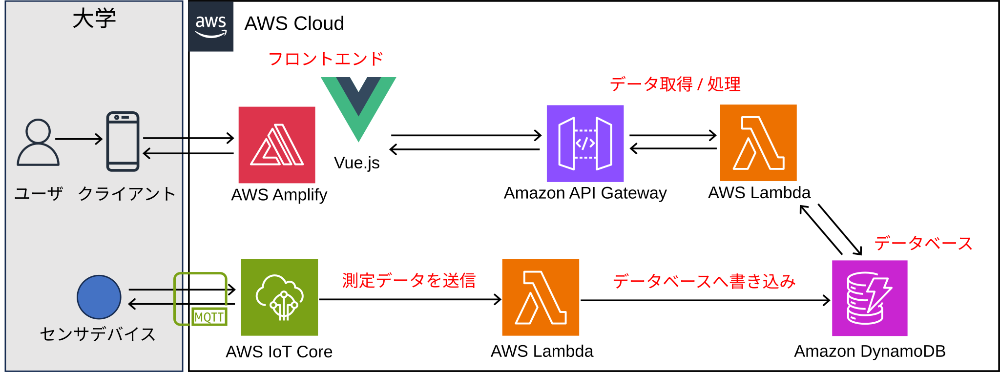

# STEP 3：スマートフォンで温度を確認しよう

[🏠 トップ](../README.md) | [← STEP 2](02-server.md) | [次へ：STEP 4 →](04-research.md)

## このSTEPの目標

**M5Stack CoreS3から送信した温度をスマートフォンのWeb画面で確認し、CoreS3本体の表示と比較します。**

STEP 1では温度を測定・表示し、STEP 2ではAWS IoT Coreへ送信しました。

このSTEPでは、送ったデータがどのようにスマートフォンに届くのかを確認します。

## 1. なぜスマートフォンで見られるの？

*図1：システム構成図*

スマートフォンは、**CoreS3と直接通信するのではありません。** 

CoreS3からAWS IoT Coreへ送られた温度データを、研修用Webページを通して確認します。

> [!NOTE]
> **AWS IoT CoreとWebページの役割**
>
> AWS IoT Coreは、CoreS3からのメッセージを受信するサービスです。
>
> 受信したデータを保存し、Webページで表示するためには、別途AWS側の処理やWebアプリケーションが必要です。これらの仕組みは講師が事前に用意します。

## 2. 研修用Webページを開く

1. 講師が案内する**研修用WebページのQRコード**をスマートフォンで読み取ります。
2. Webページを開きます。
3. 講師の指示に従って、**自分のCoreS3に対応するデバイス**を選択します。
4. **最新の温度・更新時刻・温度の履歴グラフ**を確認します。

> [!TIP]
> **自分のデバイスを確認しよう**
>
> STEP 2で使用した `secrets.h` には、`AWS_IOT_CLIENT_ID`（例：`IoT-Workshop-CoreS3-01`）が設定されています。
>
> これはAWS IoT Coreとの接続時に機器を識別する名前です。
>
> 研修用Webページでは、講師が指定したデバイス名・グループ番号を選んでください。
>
> Web画面に表示される名前がMQTTクライアントIDと同じとは限りません。
>
> `secrets.h` にはWi-Fiパスワードや秘密鍵が含まれるため、**画面撮影・SNSへの投稿・GitHubへのアップロードはしないでください。**
>
> 設定ファイルの形式だけを確認したい場合は、GitHubの[secrets_sample.h](../code/step2/secrets_sample.h)を参照できます。

<!-- 講師が実際の研修用Web画面のスクリーンショットを追加 -->
<!--  -->
<!-- *図1：スマートフォンに表示された温度と履歴グラフ* -->

## 3. Webページで確認するポイント

| 表示項目 | 確認する内容 |
| --- | --- |
| 最新温度 | 最後に届いた温度は何℃か |
| 最終更新時刻 | いつの測定データが表示されているか |
| 温度の履歴グラフ | 時間とともに温度がどのように変化したか |
| デバイス名・グループ名 | 自分のCoreS3のデータを表示しているか |

> [!IMPORTANT]
> **最新温度＝今この瞬間の温度とは限りません。**
>
> CoreS3では約1秒ごとに温度を測定しますが、STEP 2のプログラムでは約5秒ごとにAWS IoT Coreへ送信します。
>
> さらに、Webページの更新にも時間がかかることがあります。
>
> **温度の数値と最終更新時刻をセットで確認しましょう。**

## 4. CoreS3とスマートフォンの表示を比較しよう

今回は**指で温度センサの先端を温めて**変化を観察します。

1. CoreS3のディスプレイとスマートフォンのWebページを両方確認します。
2. センサに触れる前の温度を記録します。
3. **DS18B20のセンサ部分を指でしばらく温めます。**
4. CoreS3本体の温度表示やグラフがどう変化するか観察します。
5. スマートフォンの温度表示・グラフにも変化が反映されるか確認します。
6. 指を離し、温度が室温に近づく様子を観察します。

| 確認する項目 | 記録欄 |
| --- | --- |
| センサに触れる前の温度（CoreS3） | ______ ℃ |
| 温めた後の温度（CoreS3） | ______ ℃ |
| Webページで確認した最高温度 | ______ ℃ |
| CoreS3とWebページの表示に時間差はあった？ | あった / なかった |

> [!NOTE]
> **観察時の注意**
>
> - CoreS3本体やケーブルの接続部分を無理に引っ張らないでください。
> - 水や熱湯などは使用しません。
> - Webページが自動更新されない場合は、講師の指示に従って更新してください。
> - CoreS3とスマートフォンでは、データの更新タイミングが違うため、表示温度が一時的に異なる場合があります。

## 基本課題

- [ ] スマートフォンで研修用Webページを開けた
- [ ] 自分のCoreS3に対応する温度を表示できた
- [ ] 最新温度・最終更新時刻・履歴グラフを確認できた
- [ ] センサを指で温めたときの変化を観察できた
- [ ] CoreS3とスマートフォンの表示を比較できた

## チャレンジ課題

**チャレンジA：なぜ表示に時間差があるのか**

CoreS3の温度が先に変化し、スマートフォンには少し遅れて反映される場合があります。

測定・送信・保存・画面更新のどこで時間がかかると考えられますか？

**チャレンジB：どんな場所で活用できる？**

今回のように離れた場所から温度を確認できる仕組みを、学校や家庭などでどのように活用できるでしょうか？

## 考えてみよう

**CoreS3で測定した温度が、スマートフォンに表示されるまでには、どのような機器やサービスが使われていましたか？**

今日学んだ仕組みを、最初の図を見ながら説明してみましょう。

---

[← STEP 2 サーバ送信](02-server.md) | **[次へ：STEP 4 研究での活用例を知ろう →](04-research.md)**
