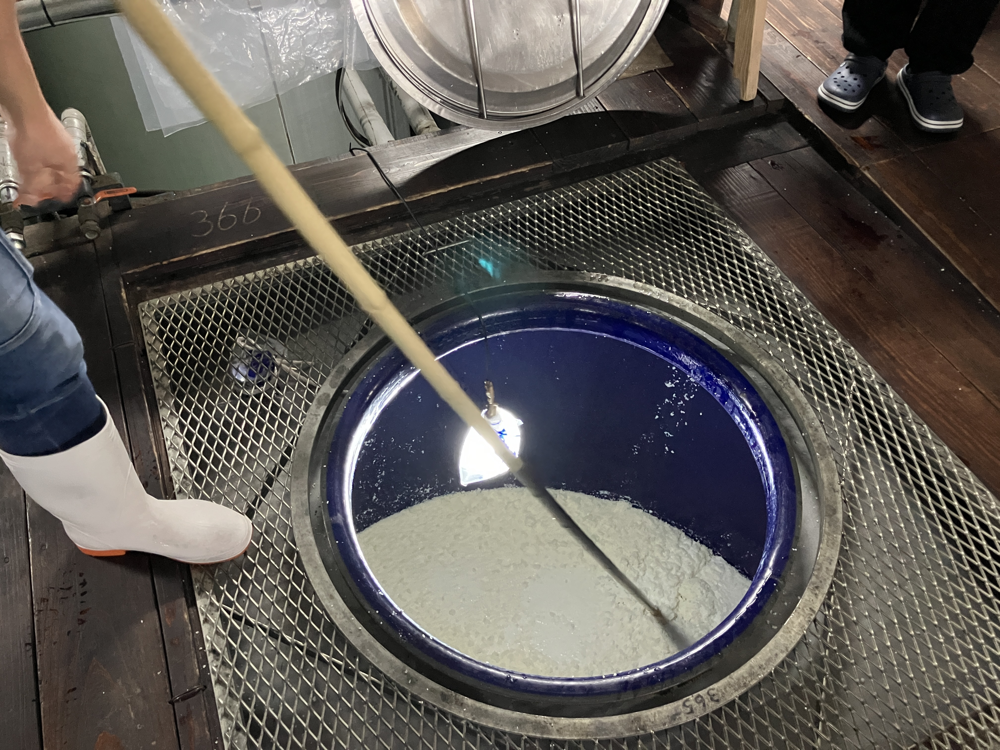
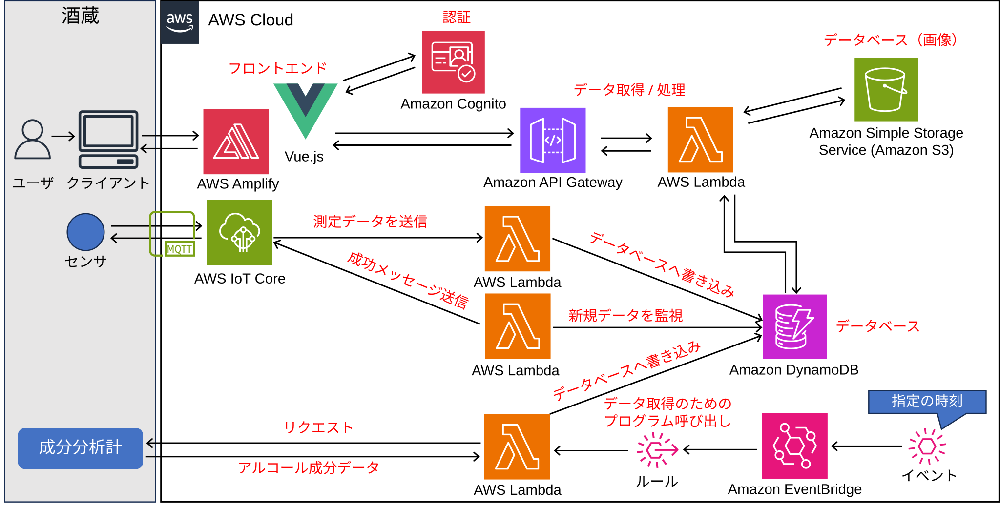
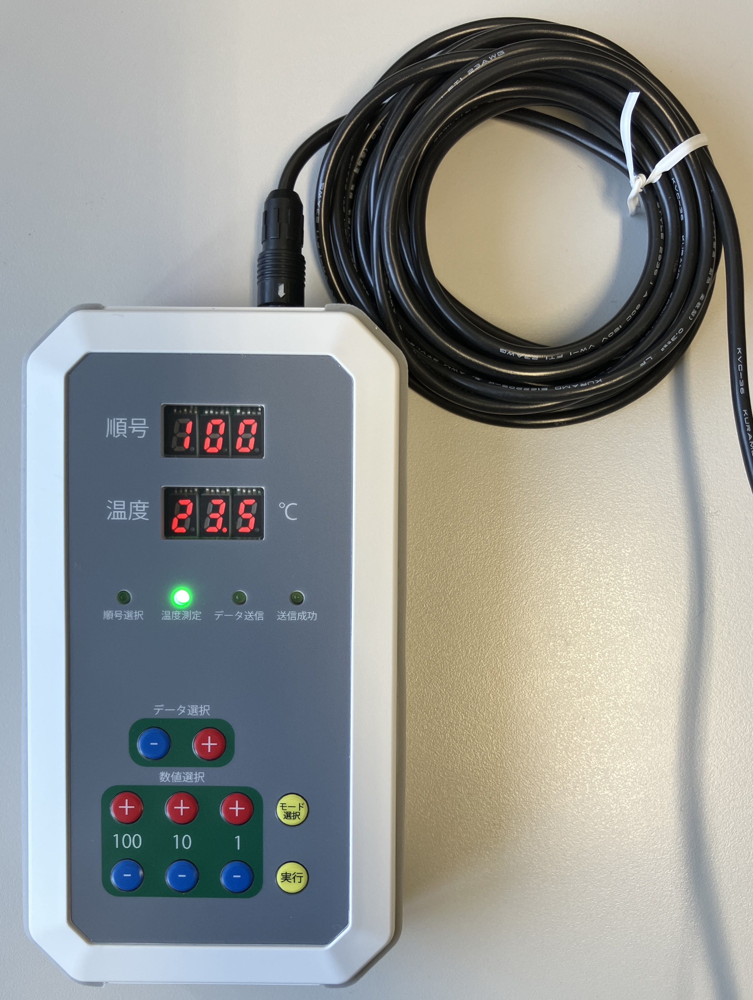
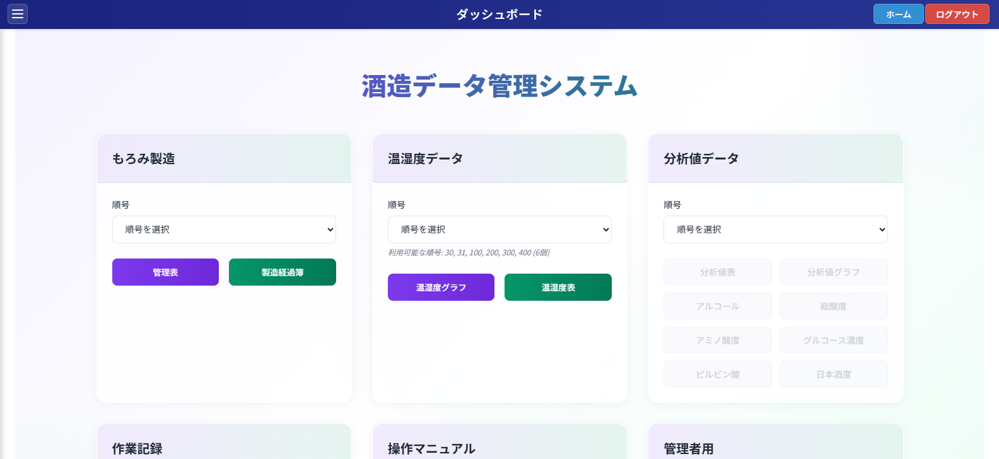
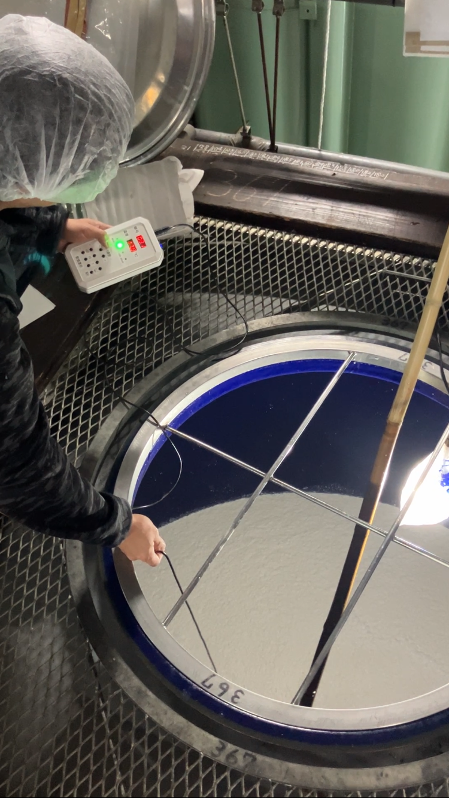

# STEP 4：実際の研究でのIoT活用を見てみよう！

[🏠 トップ](../README.md) | [← STEP 3](03-smartphone.md)

## このSTEPの目標

STEP 1〜3では、M5Stack CoreS3と温度センサを使って、温度測定・サーバへのデータ送信・スマートフォンでの確認を体験しました。

実は、これらの技術は実際の研究や産業現場でも活用されています。

このSTEPでは、**研究室で取り組んでいる日本酒醸造に関するIoT研究**を紹介します。

今回の実習で体験した技術が、実際の現場でどのように役立つのか考えてみましょう。

---

## 1. 日本酒はどのように造られる？

日本酒は、米・米麹・水などを原料として造られるお酒です。

製造工程では、麹菌や酵母などの微生物の働きを利用しています。

日本酒造りにはさまざまな工程がありますが、
今回紹介するのは **醪（もろみ）** と呼ばれるものの温度管理です。

### 醪（もろみ）とは？

醪とは、蒸した米・麹・水・酒母などをタンクの中で発酵させている液体です。

醪の中では、米のでんぷんが糖に変わり、その糖を酵母がアルコールへと変える反応が進んでいます。

この発酵の進み方は、温度によって変化します。

そのため、日本酒の品質を管理するうえで、**醪の温度を適切に管理することが重要**です。

<!-- 実際の酒蔵・醪タンクの写真を追加 -->

*図1：酒蔵における醪タンクの様子*

---

## 2. 酒蔵ではどのように温度を管理している？

日本酒造りの現場では、職人が醪の温度を定期的に測定しています。

従来の温度測定では、温度計で測定した値を確認し、その結果を手作業で記録することがあります。

例えば、次のような作業が必要です。

1. 醪タンクまで移動する
2. 醪の温度を測定する
3. 測定結果を確認する
4. 温度を紙の帳票に記録する

このような作業を複数のタンクに対して行うため、温度の測定と記録には時間や手間がかかります。

また、測定したデータを後から比較・分析するためには、紙の帳票に書かれた記録を整理する必要があります。

### 研究で解決したいこと

そこで私たちの研究室では、IoT技術を利用して、**温度の測定・記録・確認を効率化するシステム**の開発に取り組んでいます。

目指しているのは、職人の経験や技術を大切にしながら、デジタル技術で日本酒造りを支援することです。

---

## 3. IoT技術を活用した酒造データ管理システム

私たちの研究では、ESP32（マイコン）を搭載した温度測定デバイスを開発しています。

このデバイスは、醪の温度を測定し、Wi-Fiを使ってAWSにデータを送信します。

送信した温度データは保存され、Webアプリケーションから確認できるようにしています。

### システムの仕組み

このシステムでは、温度データをデジタル化することで、
測定結果の記録や過去のデータとの比較を行いやすくしています。

### 開発した温度測定デバイス

<!-- 開発した品温計の写真を追加 -->

*図2：開発した温度測定デバイス*

開発したデバイスには、次のような特徴があります。

- 温度センサを使って醪の温度を測定できる
- 測定結果を本体で確認できる
- Wi-Fiを使って温度データを送信できる
- 測定データをデジタルで記録できる

> [!NOTE]
> 今回の研修ではM5Stack CoreS3を使用しましたが、実際の酒蔵向けデバイスは使用環境に合わせて設計・開発しています。

---

## 4. 測定データをWebで確認する

温度測定デバイスから送信したデータは、クラウド上で管理されます。

私たちの研究では、AWSというクラウドサービスを利用しています。

また、温度データなどを確認するためのWebアプリケーションも開発しています。

### Webアプリケーションでできること

- 各タンクの温度データを確認する
- 過去の温度変化をグラフで確認する
- 酒蔵内の温度・湿度を確認する
- 日本酒の成分分析データを確認する

<!-- 実際のWebアプリケーションの画像を追加 -->

*図3：開発したWebアプリケーション*

### 温度以外のデータも管理する

日本酒造りでは、温度以外にもさまざまなデータが重要です。

例えば、次のようなデータがあります。

| データ | 何が分かる？ |
| --- | --- |
| 醪の温度 | 発酵中の温度変化 |
| 酒蔵内の温度・湿度 | 製造環境の状態 |
| アルコール濃度 | アルコールの生成状況 |
| 糖分などの成分 | 発酵の進み具合を判断するための情報 |

私たちの研究では、こうしたデータをまとめて管理し、日本酒造りの品質管理や判断を支援することを目指しています。

---

## 5. 実際の酒蔵で使ってみた

研究室で開発したシステムは、実際の酒蔵でも試験的に導入・評価しています。

協力いただいているのは、大分県国東市にある **萱島酒造** です。

実際の酒蔵で使用することで、研究室の中だけでは分からない課題を発見できます。

### 実際の使用風景

<!-- 酒蔵での試験導入写真を追加 -->

*図4：実際の酒蔵で温度測定デバイスを使用している様子*

### 実際に使用して分かったこと

試験導入では、温度の測定結果をクラウドへ送信・記録できることを確認しました。

また、酒蔵の作業環境に適したセンサプローブの形状や、温度測定デバイスの使いやすさなど、改良が必要な点も見つかりました。

単にシステムが動くことだけでなく、**実際に使う人にとって便利かどうか**を確認することも重要です。

---

## 6. 今回の実習と比較してみよう

ここまで紹介した研究と、今回の実習を比較してみましょう。

| 項目 | 今回の実習 | 酒蔵での研究 |
| --- | --- | --- |
| 温度測定 | DS18B20 | DS18B20 |
| マイコン | M5Stack CoreS3 | ESP32 |
| 通信 | Wi-Fi・MQTT | Wi-Fi・MQTT |
| クラウド | AWSの各種サービスを活用 | AWSの各種サービスを活用 |
| データの確認 | スマートフォンのWeb画面 | 酒蔵向けWebアプリケーション |
| 主な目的 | IoTの仕組みを学ぶ | 温度管理・記録作業の効率化 |

使用する機器や目的には違いがありますが、基本的な仕組みには共通点があります。

**センサで測定 → ネットワークで送信 → データを保存 → Webで確認**

今回の実習で体験した技術は、実際の研究や社会でも活用できる技術です。

---

## 7. 考えてみよう

ここまでの研究紹介を振り返り、次のことを考えてみましょう。

### 問題1

今回の実習と、酒蔵向けIoTシステムにはどのような共通点がありましたか？

### 問題2

温度を紙に記録する方法と、自動的にクラウドへ保存する方法には、それぞれどのような良い点があるでしょうか？

### 問題3

今回学んだIoTの仕組みを使って、身の回りのどのような問題を解決できそうですか？

---

## このSTEPのまとめ

今回のSTEPでは、日本酒造りでのIoT技術の活用例を紹介しました。

IoT技術を使うことで、離れた場所からのデータ確認や、測定結果のデジタル化が可能になります。

一方で、実際の現場で使いやすいシステムにするためには、利用する人の意見を聞きながら改良を続けることも大切です。

**今回体験したIoTの技術が、実際の社会でどのように活用されているかを考えてみましょう。**

---

[← STEP 3 スマホ確認](03-smartphone.md) |
